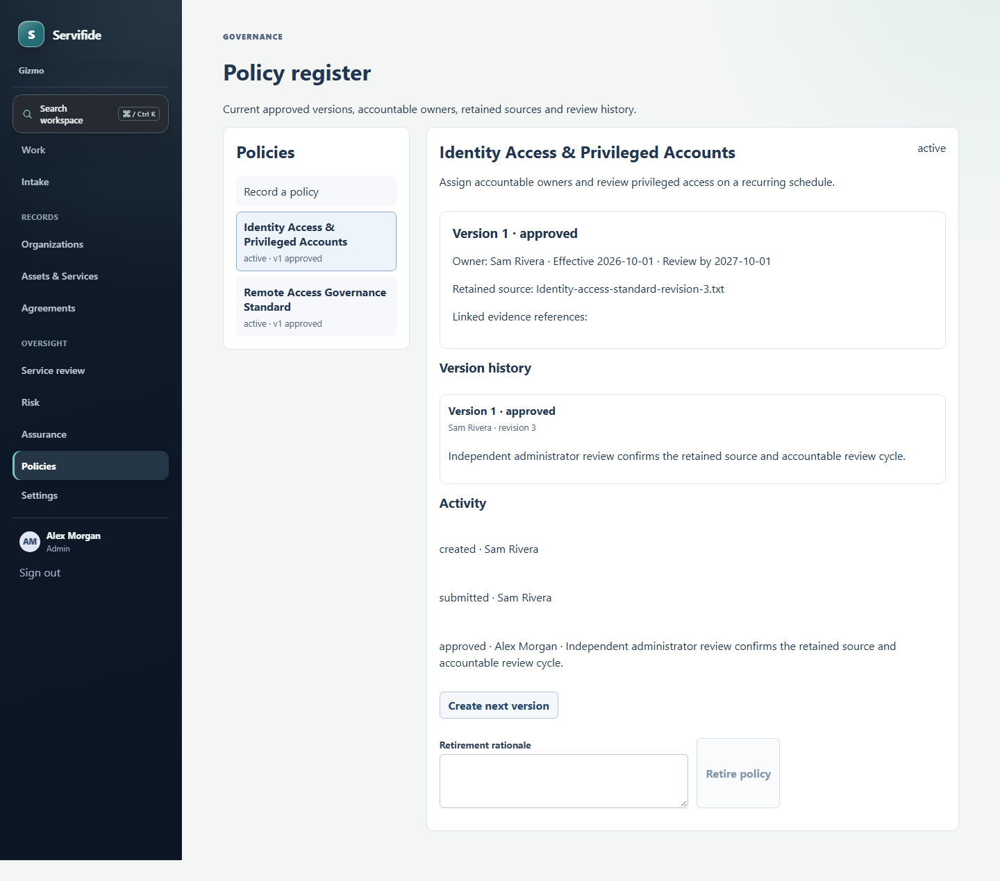
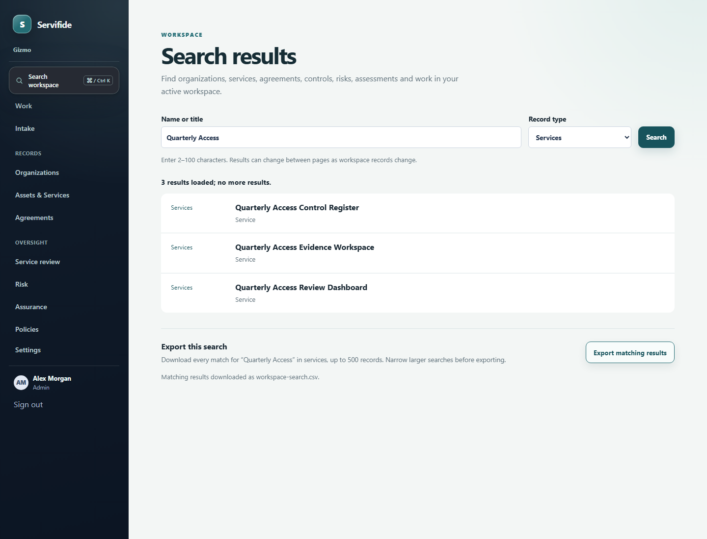

# Servifide demo

As an organization grows, it gets harder to answer basic questions: Which services do we use? Who provides them? Which agreement covers them? Who owns the work when something is missing? Servifide brings those answers together so leaders can see where a decision or follow-up is needed.

This public gallery shows the workflow with fictional records, people, and organizations. The working application and its source stay private. This repository contains screenshots, not a live demo.

## Start with the Policy register

The register shows who owns a policy, which version is approved, when it is due for review, and which source and evidence references support it. The retained history shows who submitted and approved the version and why.

## Find the records behind a decision

Search narrows the inventory to the records you need. This example finds services used for quarterly access reviews and shows an export of the results.

For a closer look, see the [service detail](assets/servifide-service-detail-capture.png) for provider and agreement coverage, or the [relationship workshop](assets/servifide-relationship-workshop-capture.png) for a service linked to its provider and agreement. The [Work screen](assets/servifide-work-synthetic.png) illustrates how missing providers and owners become visible. These supporting captures retain generated fixture names.

## One operating toolkit

| Tool | Question it answers |
| --- | --- |
| [GYST](https://github.com/lpayt402/gyst) | What evidence supports the record? This is the public evidence tool. |
| Servifide | What do we use, who provides it, and what needs a decision? This gallery is public; the application is private. |
| Obligation Tracker | Who follows through, and when do we check again? This tool is private. |
